<div align="center">

# OpenChore

**The chore chart your kids actually check.**

A self-hosted family chore tracker for the kitchen wall. Kids earn points,
keep streaks and spend points in a rewards store. Parents set the rules once
and stop nagging.

[](https://github.com/liftedkilt/openchore/releases)
[](https://github.com/liftedkilt/openchore/actions/workflows/build.yml)
[](LICENSE)

[**Website**](https://liftedkilt.github.io/openchore/) ·
[**Quick start**](#quick-start) ·
[**Screenshots**](#a-look-around) ·
[**Docs**](#documentation)

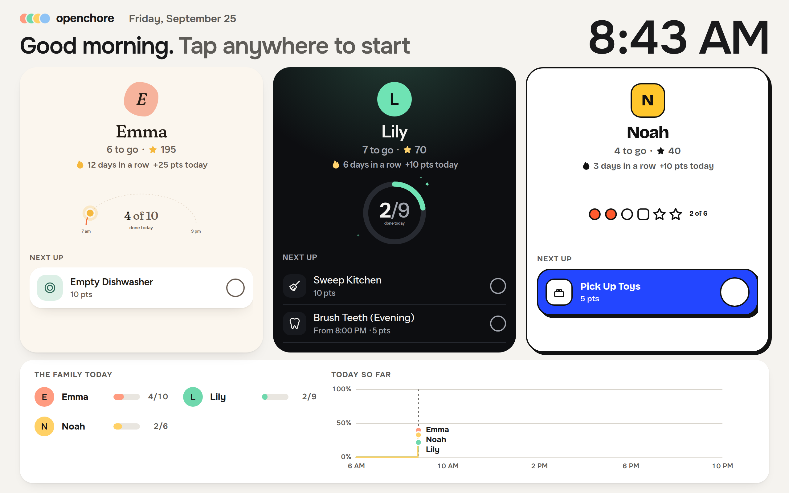

</div>

## Why families use it

Chore charts fail because nobody looks at them. OpenChore is built to run on a
tablet in the place everyone already walks past, so the chart is always in
front of them.

- 🎨 **Each kid gets their own look.** Everyone picks a skin (warm
  **Sunroom**, bold **Blocks** or dark **Tint**) and a colour. A five-year-old
  and a teenager see the same app, but each sees a version made for them.
- ⭐ **Points that mean something.** Kids earn points for chores and spend them
  on rewards you choose, at prices you set. Every point is recorded, so
  there's never an argument about the balance.
- ✅ **Fair rules, enforced for you.** Bonus points only pay out once the
  must-do chores are done. Deadlines, time windows, streaks and penalties run
  on their own, not on you at 9pm.
- 📸 **Proof when you want it.** Mark a chore as needing approval, and kids
  send a photo for you to sign off.
- 🏠 **Your data stays home.** It's one small server and one database file on
  your own hardware. No account, no subscription, no tracking.

## Quick start

You need [Docker](https://docs.docker.com/get-docker/).

```bash
git clone https://github.com/liftedkilt/openchore.git
cd openchore
docker compose up -d
```

Open **http://localhost:8080**. A setup wizard walks you through adding
parents and kids, picking skins and choosing a few starter chores. That takes
about five minutes.

> [!TIP]
> **Set your time zone.** Deadlines and morning/evening chores depend on it.
> Change `TZ=America/Los_Angeles` in `compose.yaml` to
> [your zone](https://en.wikipedia.org/wiki/List_of_tz_database_time_zones)
> before you start.

<details>
<summary><b>Want to look around first? Load the demo family.</b></summary>

```bash
cp config/config.example.yaml config/config.yaml
docker compose up -d
```

This loads a sample household with chores, rewards and streaks. The parents'
PINs are `1234` (Alex) and `5678` (Jamie). Tap a parent, enter the PIN, then
tap **Manage**.

The config file is only read when the database is empty. To start over, run
`./redeploy.sh --wipe`. Change the demo PINs before you put OpenChore on your
network (tap your avatar, then **Change PIN**).

</details>

Then put it on a tablet: open the page in the browser and choose **Add to Home
Screen**. It runs full-screen like an app.

## How it works

### Must-do first, bonus last

Every chore belongs to one of three tiers, and each tier waits for the one
before it:

| Tier | What it means |
|------|---------------|
| **Required** | The non-negotiables, like brushing teeth or feeding the dog. |
| **Core** | The daily routine. Points are held until every required chore is done. |
| **Bonus** | Optional extras. They only pay out once required *and* core are finished. |

So nobody can skip the dishes to grab the 15-point bonus chore.

### The other levers

- **Time windows.** A chore can stay hidden until a set time, and the day is
  grouped into morning, afternoon and evening.
- **Deadlines.** After the deadline, you choose whether a chore is blocked,
  worth no points, or costs points.
- **Streaks.** Days in a row with everything done, with bonus points at
  milestones you set.
- **Daily decay (optional).** A small points charge when yesterday was left
  unfinished.
- **Savings goals.** Kids can put points aside for a big reward, alone or
  pooled with siblings.
- **Vacation mode.** Pause a kid's chores when they're sick or away, without
  touching the schedule.

Parents can take part too: give yourself chores and points, or tick a chore
off on a kid's behalf.

## A look around

### Three skins, one app

Every kid's screen has the same tabs, the same chore list and the same
one-tap check. Only the look changes, and so does the progress display: a sun
arc, a ring, or a row of shapes.

<table>
<tr>
<td width="33%">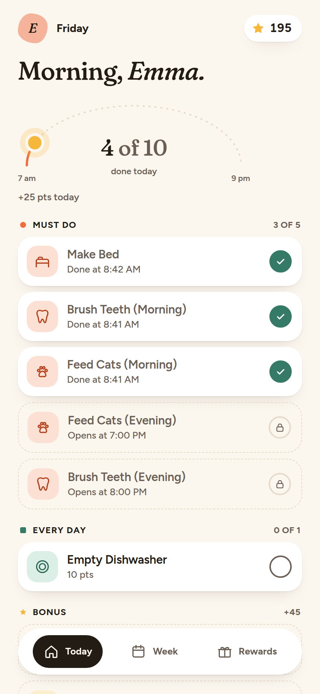</td>
<td width="33%">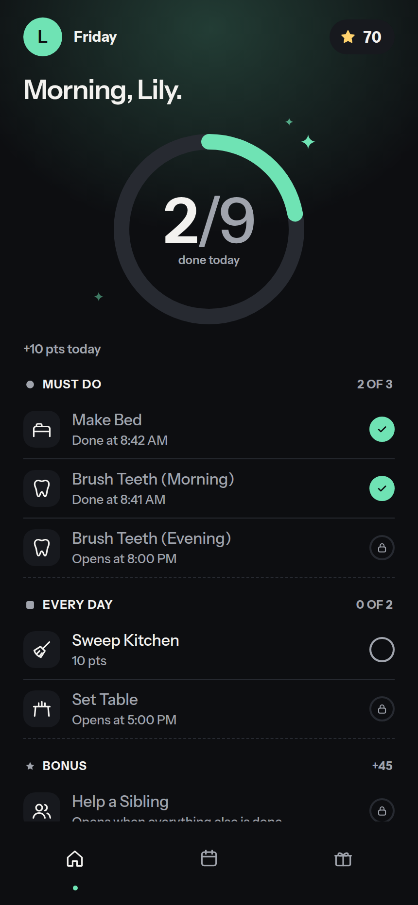</td>
<td width="33%">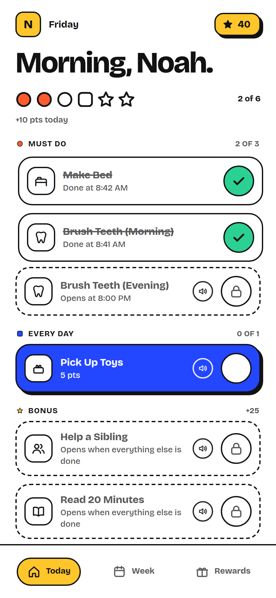</td>
</tr>
<tr>
<td align="center"><b>Sunroom</b>: warm and soft</td>
<td align="center"><b>Tint</b>: calm and dark, lit in your colour</td>
<td align="center"><b>Blocks</b>: bold and graphic</td>
</tr>
<tr>
<td>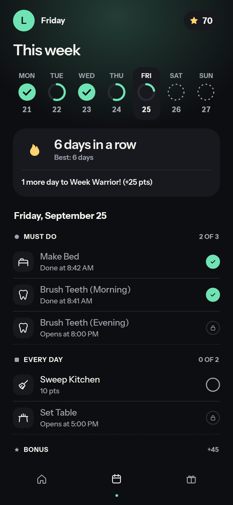</td>
<td>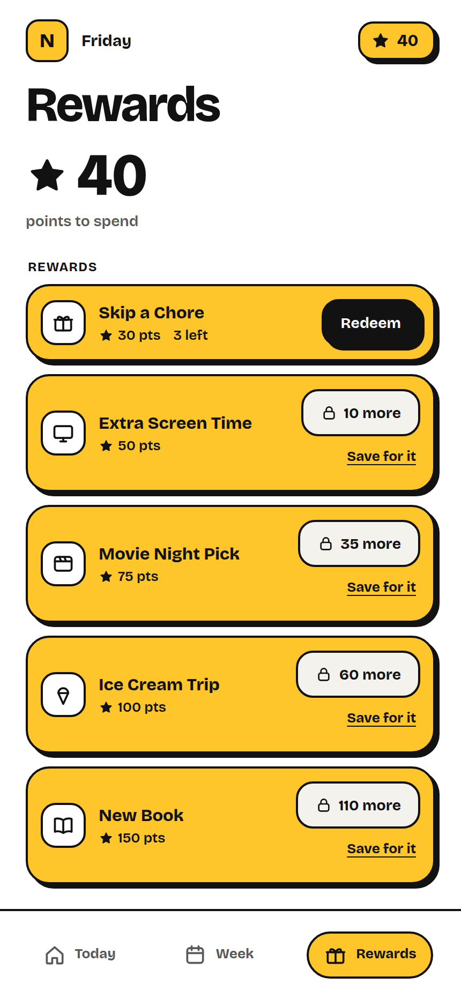</td>
<td>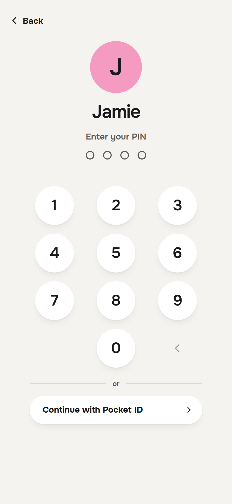</td>
</tr>
<tr>
<td align="center"><b>Week</b>: each day's ring and the streak</td>
<td align="center"><b>Rewards</b>: spend now or save up</td>
<td align="center"><b>Sign in</b>: PIN or single sign-on</td>
</tr>
</table>

### Screens for the whole family

Shared screens use a neutral look called **House** (and **House Dark** for the
evening), so nobody's skin takes over. Each person shows up in their own
colour.

<table>
<tr>
<td width="50%">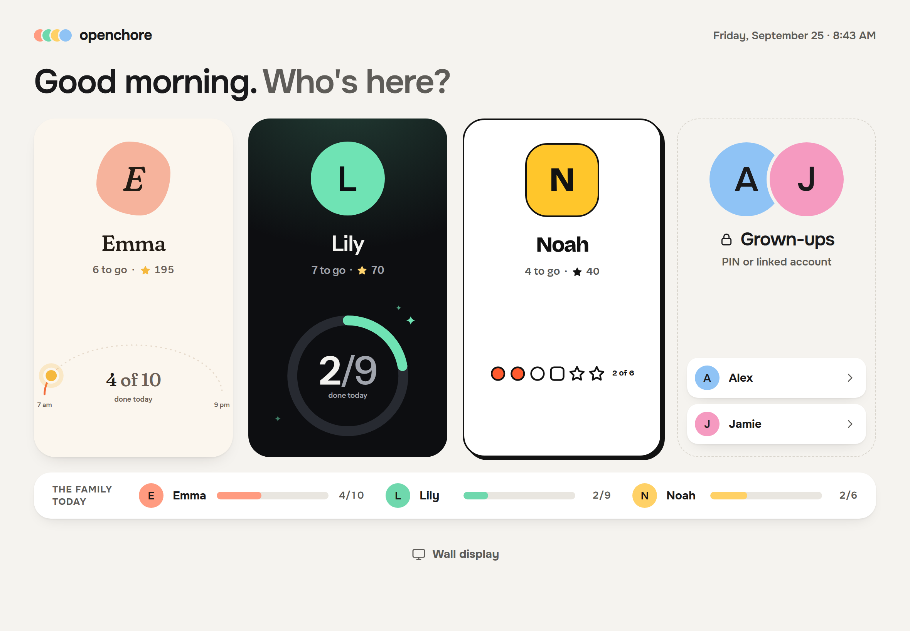</td>
<td width="50%">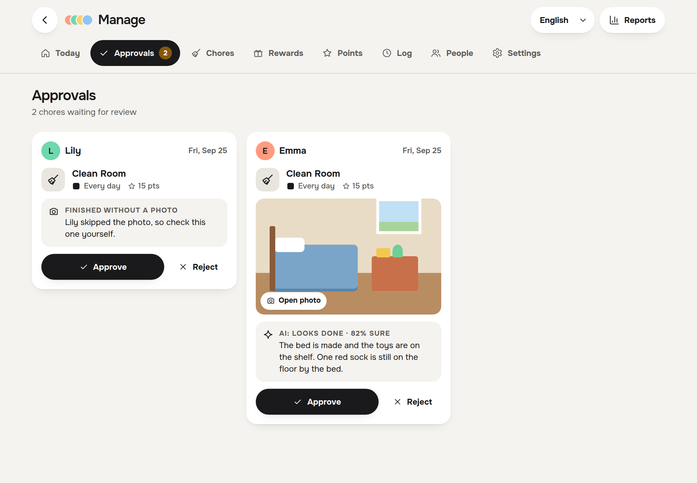</td>
</tr>
<tr>
<td align="center"><b>Who's here?</b> Tap your door to start</td>
<td align="center"><b>Approvals</b> with photo proof</td>
</tr>
<tr>
<td>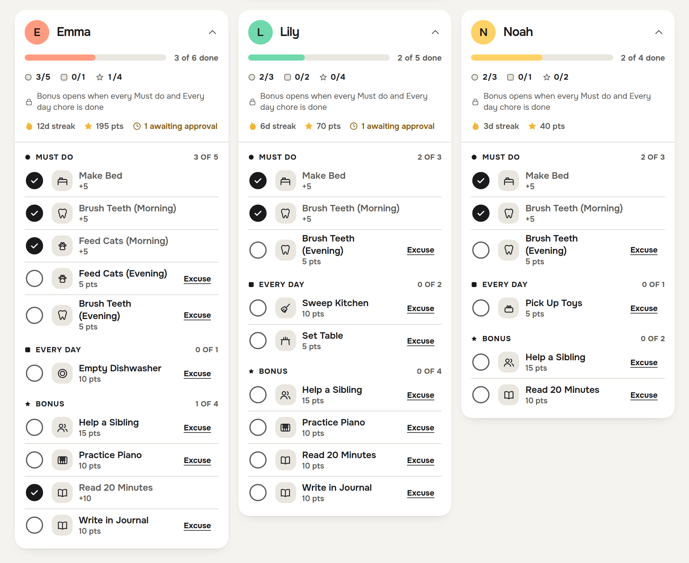</td>
<td>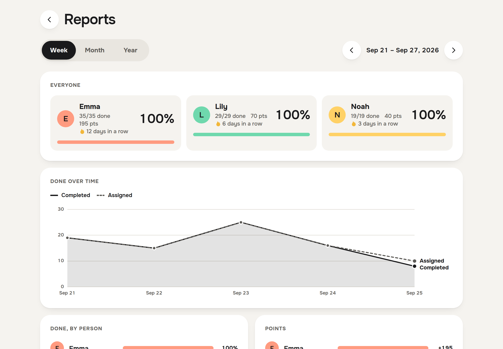</td>
</tr>
<tr>
<td align="center"><b>Manage</b>: everyone's day at a glance</td>
<td align="center"><b>Reports</b>: scorecards, trends and what gets missed</td>
</tr>
</table>

## Features

<table>
<tr><td valign="top" width="33%">

**Scheduling**
- Weekly, every N days, or one-off
- Time windows and deadlines
- Assign to one kid or several
- Family and first-come chores
- Quick-assign for one-off jobs
- Vacation mode

</td><td valign="top" width="33%">

**Points and rewards**
- Full points history
- Rewards store with stock limits
- Per-kid prices and visibility
- Savings goals and family pools
- Streak milestones
- Optional decay and penalties

</td><td valign="top" width="33%">

**For the household**
- Parent approval with photo proof
- Parents can take part too
- PINs or single sign-on (OIDC)
- Reports and weekly scorecards
- Discord notifications
- English and German

</td></tr>
<tr><td valign="top">

**For kids**
- Chores read aloud
- Swipe or tap to complete
- Big tap targets
- Shapes as well as colours
- Wall display mode
- Installs as an app (PWA)

</td><td valign="top">

**Smart extras (optional)**
- AI notes on photo proof
- Weekly family summaries
- Drafts chore descriptions
- Natural-sounding read-aloud voices

</td><td valign="top">

**For tinkerers**
- Signed outbound webhooks
- Trigger URLs per chore (great with Home Assistant)
- API tokens and a [REST API](docs/api.md)
- [MCP server](docs/mcp.md) for AI assistants

</td></tr>
</table>

## Optional AI

Everything works without AI. If you want it, OpenChore can use any
OpenAI-compatible model, running on your own machine or hosted:

- **Photo notes.** A vision model takes a first look at photo proof and leaves
  a note for you. It can auto-approve, but it never rejects. You always have
  the final say.
- **Weekly summaries** of how each kid's week went.
- **Chore descriptions** drafted for you.
- **Read-aloud voices** for kids who are still learning to read. Without a
  speech service, the browser's built-in voice is used.

To run the models locally next to OpenChore, add this to a `.env` file:

```bash
AI_BASE_URL=http://llama:8080/v1
AI_MODEL=gemma-4-e4b
TTS_BASE_URL=http://kokoro:8880/v1
```

Then start the extra services:

```bash
docker compose --profile ai --profile tts up -d   # ~6 GB RAM for AI, ~2 GB for voices
```

You can also set this up later under **Manage → Settings**. See
[AI features](docs/ai.md) for Ollama, hosted APIs and choosing a model.

## Configuration

Most settings live in the app under **Manage → Settings**. These environment
variables cover the rest:

| Variable | Default | Purpose |
|----------|---------|---------|
| `TZ` | system | **Set this.** Deadlines and time windows depend on it |
| `WEB_PORT` | `8080` | Port the app is served on |
| `DB_PATH` | `openchore.db` | Where the SQLite database lives |
| `CONFIG_PATH` | `config/config.yaml` | Seed file, read only when the database is empty |
| `AI_BASE_URL`, `AI_MODEL`, `AI_API_KEY` | none | AI model ([details](docs/ai.md)). Overrides the in-app setting |
| `TTS_BASE_URL`, `TTS_MODEL`, `TTS_API_KEY` | none | Speech service for read-aloud. Overrides the in-app setting |
| `OIDC_ISSUER`, `OIDC_CLIENT_ID`, `OIDC_CLIENT_SECRET`, … | none | A single sign-on provider ([details](docs/authentication.md)) |
| `OPENCHORE_PUBLIC_URL` | request host | Public URL, used for sign-on redirects |
| `OPENCHORE_SESSION_SECRET` | generated | Session signing key (32+ characters) |
| `PORT` | `8080` | API listen port inside the container |
| `POINTS_DECAY_INTERVAL` | `15m` | How often the decay check runs |

## Upgrading to 1.0

1.0 is the first versioned release. It brings a redesigned app, skins and
colours for each person, sign-in on each profile, and AI that only advises.
Pull the new images and restart (`docker compose pull && docker compose up -d`).
Migrations run on start, old themes map to the new skins, and everyone gets a
colour.

Two things need your attention:

- **Sign-in.** The household passcode is gone. Every parent now needs their
  own PIN or linked account. See
  [Upgrading from the household passcode](docs/authentication.md#upgrading-from-the-household-passcode).
- **AI.** The LiteRT/Ollama settings are replaced by any OpenAI-compatible
  endpoint. See
  [Upgrading from the LiteRT/Ollama setup](docs/ai.md#upgrading-from-the-litertollama-setup).

## Documentation

- [Signing in](docs/authentication.md): PINs, parents, sessions, single sign-on
- [AI features](docs/ai.md): photo review, summaries, voices, choosing a model
- [API reference](docs/api.md): endpoints, tokens and webhook events
- [AI assistants (MCP)](docs/mcp.md): run the household from Claude or another MCP client
- [Roadmap](ROADMAP.md): what's shipped and what's next

## Contributing

OpenChore is a Go API with a React + TypeScript front end and a SQLite
database. You need Go 1.25+ and Node 22+.

```bash
make install    # Go modules + npm packages
make dev        # wipes the DB, seeds the demo family, runs the API (:8080) and Vite (:5173)
make test       # Go integration tests against a real SQLite DB
make test-e2e   # Playwright suite on a fresh database
make build      # static binary + production bundle
```

> [!WARNING]
> `make dev` deletes the database every time it runs. Point `DB_PATH`
> somewhere else if you want to keep your data.

Architecture notes and conventions are in [CLAUDE.md](CLAUDE.md). Issues and
pull requests are welcome.

## License

[MIT](LICENSE)
